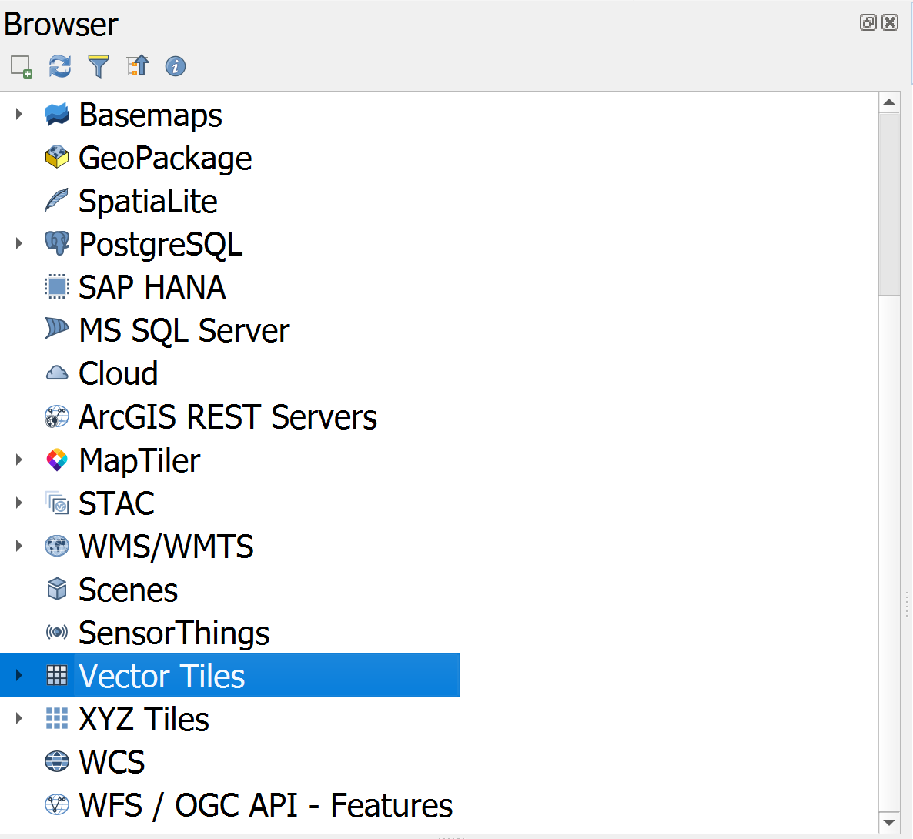
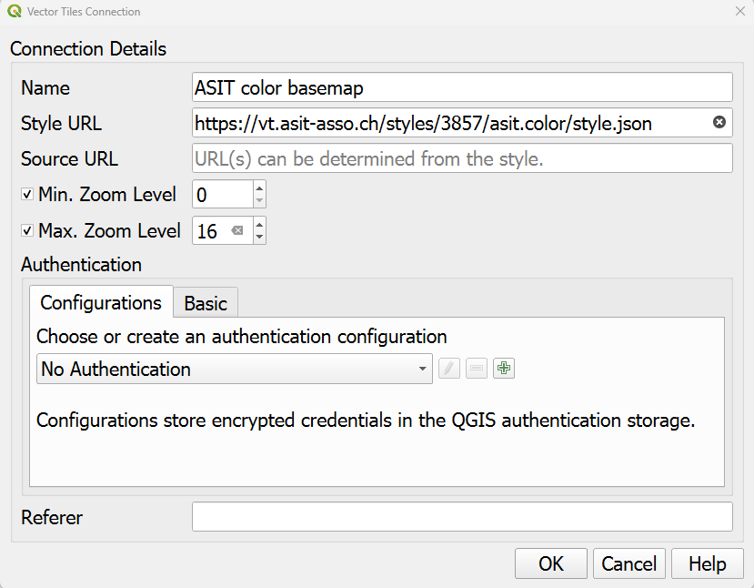

## QGIS

QGIS can integrate vector tiles layer but only in Web Mercator coordinate system (EPSG:3857).

In the QGIS browser panel, right-click on "Vector Tiles" and choose "New Generic Connection..."

{width="500"}

In the Vector Tiles Connection window, name the new connection the way you want, paste the URL to a `style.json` file (see [styles](../index.md#styles)), set the min and max zoom level of the underlying tileset (see [tiles](../index.md#tiles)) and click ok.

{width="600"}

You can now load the new layer on the canvas.

**Caveat**

The labelling defined in the `style.json` files are translated as QGIS labels and are therefore always rendered on the top of every layers on the canvas. You can prevent that with overlapping vector layers by setting their labels as `blocking` with maximum weight.